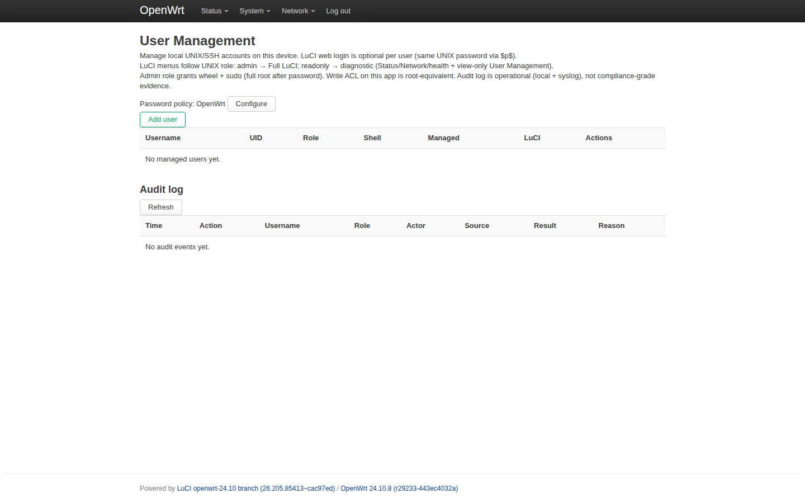
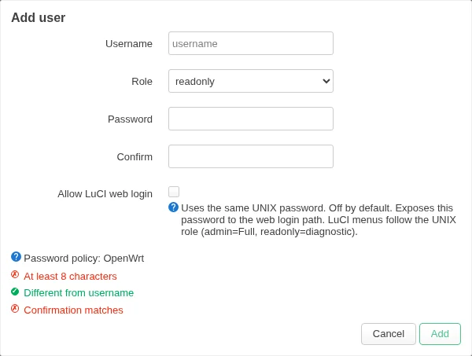
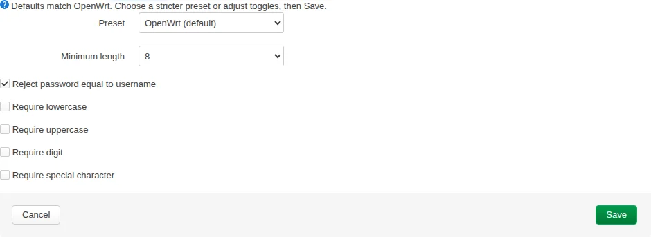
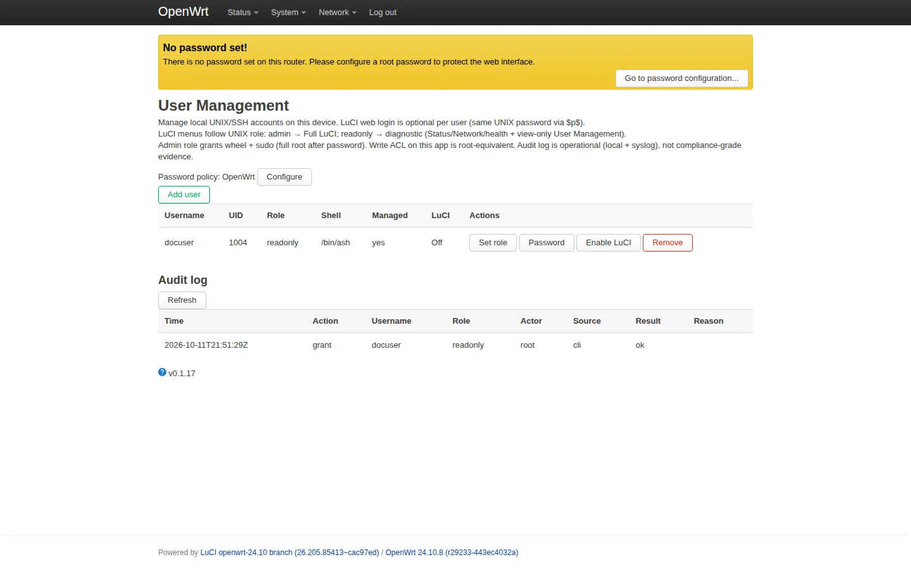

# Using User Management

Open **System → User Management** in LuCI after you [install](installation.md) both packages. This page manages **local UNIX/SSH accounts**. LuCI web login for those accounts is optional and off by default.

English UI only. Factory password policy is **OpenWrt** (minimum 8 characters; password must not equal the username) until you open **Configure** and click **Save**.

## Empty table (first visit)

1. **Password policy** strip shows the active preset (OpenWrt until you Save a change).
2. **Add user** creates a managed UNIX account.
3. The table lists managed users. An empty lab or a new install shows **No managed users yet.**
4. **Audit log** records operational events on this device (not compliance-grade evidence).

Root (or a Full LuCI session) can add, change roles, set passwords, and enable LuCI login. A readonly diagnostic login can **view** this page only.

## Add a user

1. **Username** — OpenWrt username rules (`[a-z_][a-z0-9_-]*`).
2. **Role** — **readonly** (SSH only, no sudo) or **admin** (wheel + sudo to root after password).
3. **Password / Confirm** — checked live against the current policy. The gallery leaves these empty on purpose; never put a real password in a screenshot.
4. **Allow LuCI web login** — opt-in. Off keeps the account SSH-only. On uses the same UNIX password (`$p$user`). Menus follow the UNIX role: admin → Full LuCI; readonly → diagnostic.

## Password policy

**Configure** expands presets (**OpenWrt**, **Standard**, **Strict**, **Custom**) and individual toggles. Nothing is stored until **Save**. Read-only sessions see the policy **name** only.

## One managed user

The table row is the managed account. **LuCI** is **Off** until you enable web login. Actions (write sessions only): Set role, Password, Enable/Disable LuCI, Remove.

The screenshot uses the documented fixture name `docuser`. Lab smoke names such as `umadmin` do not belong in published docs.

Roles and ACL detail: [roles-and-acl.md](roles-and-acl.md).
